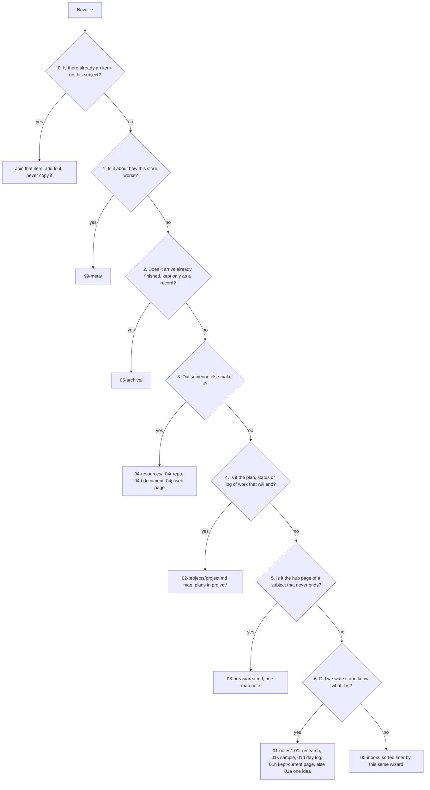

# Knowledge stores

Read this before saving notes, research, captured pages, or other learning
material, or when setting up or reorganizing a place that holds them. A
**store** is any folder that keeps knowledge: a knowledge repository's
root, a code repository's `docs/knowledge/`, or a project's shared files
folder. The goal is that two agents saving the same file pick the same
folder and the same name, and that a reader finds anything by following
at most three written lists.

## Contents

- [Which store?](#which-store)
- [The tree](#the-tree)
- [The wizard](#the-wizard)
- [Item shape](#item-shape)
- [Naming rule](#naming-rule)
- [Hubs and maps](#hubs-and-maps)
- [Checks](#checks)
- [Adopting the standard](#adopting-the-standard)

## Which store?

Ask first: is the file about this repository's own system, saying why it
is so, what it is, or how to run or change it?

- **Yes:** it is documentation. It goes in the repository's `docs/` kind
  folders (`decisions/`, `runbooks/`, `specs/` and the like) and follows
  the docs rules in `SKILL.md`, not this file.
- **No:** it is knowledge, something learned or gathered. It goes in the
  knowledge store, and the wizard below places it. In a code repository
  the knowledge store is `docs/knowledge/`, and the docs checks (front
  matter, prose linting) skip that folder.

A docs folder that holds the evidence behind decisions is named
`evidence/`, one summary per decision, linking to the full research in
the knowledge store. Keep the word "research" for the knowledge store, so
a folder name never answers yes to both sides of the question above.

## The tree

```text
<store>/
├── README.md          hub: a written map of the top folders
├── 00-inbox/          not sorted yet
├── 01-notes/          we wrote it
│   ├── 01a-atomic/      a note on one idea
│   ├── 01d-daily/       a log of one day's work
│   ├── 01h-handbook/    pages kept current that hold many ideas: vocabularies, policies, profiles
│   ├── 01r-research/    research: numbered batches NNNN-<name> in run order, and studies <name>
│   └── 01s-samples/     code or prototypes built as examples
├── 02-projects/       work that will end: one map note per project, <project>.md, its plans in <project>/
├── 03-areas/          subjects that never end: one map-of-content note per area, <area>.md
├── 04-resources/      someone else made it; kept to reference
│   ├── 04p-pages/       captured web pages and snipped pages
│   ├── 04d-documents/   papers, PDFs, exports
│   └── 04r-repos/       repository captures: outside repos, their files and code
├── 05-archive/        arrived finished, kept as it was
└── 99-meta/           how this store works: ORGANIZE.md, tools, setup
```

The top folders are INPARA: Inbox, Notes, Projects, Areas, Resources,
Archive, plus `99-meta/`. Top folders are `NN-name`; second-level folders
in `00-inbox/`, `01-notes/` and `04-resources/` are `NNx-name`, with the
parent's number. A new lettered folder is added only by a new version of
the standard, never by an agent saving a file. Create each folder when
its first file arrives.

## The wizard

Ask in order. The first yes decides.



| # | Question | If yes | Test for the hard cases |
|---|---|---|---|
| 0 | Is there already an item on this subject? Read the hub lists from `README.md` down and search the names. | Join it. A one-file item becomes a folder (see item shape). | A copy of an item is never a new item. |
| 1 | Is it about how this store works: its rules, checks, tools, templates, or setup? | `99-meta/` | A tool serving one item goes in that item's `scripts/`. A page on how we work in general (a vocabulary, tool choice, review rules) is a handbook page (step 6). |
| 2 | Does it arrive already finished or replaced, kept only as a record (an old snapshot, a chat export)? | `05-archive/<name>/`, unchanged | An item already saved that later finishes **stays where it is** with `status: replaced` in its front matter, so links keep working. Only something retired as a whole record goes to the archive. |
| 3 | Did someone else make it? | `04-resources/`: `04r-repos/` for a repository capture, `04d-documents/` for a file document, `04p-pages/` for a web page | Our notes about it are not a resource: they go to step 6 and link to it. |
| 4 | Is it the plan, status, or log of one piece of work that will end? | `02-projects/<project>/`, linked from the map note `02-projects/<project>.md` | The project folder has no README; its map note is its hub. Would it still be useful after the project ends? Then it is a note, and the project map links to it. |
| 5 | Is it the hub page of a subject that never ends? | `03-areas/<area>.md`, one map note, no folder | The map is a list of links, each with a reason. Everything it links lives elsewhere. A living page about the area (a catalogue, a status page) is a handbook note the map links. |
| 6 | Did we write it, and do we know what it is? | `01-notes/`: `01r-research/` for research, `01s-samples/` for example code, `01d-daily/` for one day's log, `01h-handbook/` for a page kept current that holds many ideas, otherwise `01a-atomic/` | A research batch has a number in the store's batch register; anything else with sources and findings is a study and takes no number. A note on one idea is atomic even when edited later. |
| - | None of the above | `00-inbox/` | Sorted later with this same wizard. |

**Tie rule:** if two answers still fit, pick the one a stranger would look
in first, and say why in the item's main file.

Projects and areas are the human front end: a person browses maps. Notes
and resources are kept by agents, and every one of them is reachable from
some map.

## Item shape

- A new item starts as **one file**. It becomes a folder named for the
  item when its second file arrives. The folder holds `README.md` (the
  main text) and only these inner folders, each made when its first file
  arrives: `data/`, `scripts/`, `sources/`, `drawings/`.
- **One home, many links.** An item can belong to many areas and
  projects. Each one links to it; nothing is copied.
- The main file starts with front matter. The `description` is what the
  hub shows, so write the words someone would search for:

  ```yaml
  ---
  title: Joining the private network as an agent
  description: How a cloud agent joins the private network with a tag, and how to revoke it.
  status: draft | current | replaced
  date: 2026-11-03
  ---
  ```

## Naming rule

1. **Slug from the title.** Take the title or first heading, drop "a",
   "an" and "the", keep the first five words, write them lowercase-kebab:
   "How the agent joins the network" becomes `how-agent-joins-network.md`.
2. **No IDs, dates, timestamps, or versions in names.** The date goes in
   front matter; git keeps versions. One exception: a research batch
   folder directly under `01-notes/01r-research/` is `NNNN-<name>`, its
   register number, so batches sort in run order. Files inside it carry
   no number.
3. **No catch-all words** (misc, general, other, temp, old, backup, new),
   and a name never repeats a folder name higher up its own path.
4. **Collisions.** Same subject: it is the same item, so join it. A
   different subject: add the title's next word until the slug is unique.
   Never add a number.
5. **Never rename after saving.** Links point at names, and repeated
   renames are the largest cost a reorganization has. Fix the title in
   front matter instead.
6. **Capitals only for role files:** `README`, `AGENTS`, `CLAUDE`,
   `ORGANIZE`, `LICENSE`, `SECURITY`, `CHANGELOG`, `CONTRIBUTING`,
   `CODEOWNERS`, `SKILL`, and research-batch template files (`SPEC`,
   `SYNTHESIS`, `LEDGER`, `DEVIATIONS`, `PRIOR-CORPUS`, `RECALL`,
   `REVIEW`, `CORRECTIONS`). Python files are `snake_case.py`.
7. **Limits:** 63 characters per folder name, 255 per path, no Windows
   device names.

## Hubs and maps

A reader should choose without opening files, and trust that the lists
are complete.

- Every hub `README.md` (the root, each top folder, each lettered folder)
  is a written map: it links every child, each link with its description
  on the same line. Read `README.md`, then a top hub, then a lettered hub
  or a map note, then the one item: three levels to anything.
- The root `README.md` says in one sentence: "Before saving, run the
  wizard in 99-meta/ORGANIZE.md; to find anything, follow the hub lists
  from here."
- Every item in `01-notes/`, `04-resources/`, or a project folder is
  linked from at least one area or project map. A hub link does not
  count: a map link says why the item matters to that subject.
- Hubs and maps are written by hand; the checks keep them complete. Hand
  lists without a check go stale, and generated lists lose the reason
  each link exists.
- An agent that uses the store names the files it opened, so a reader
  can check what its answer rests on.

## Checks

Run `scripts/check_knowledge_store.py <store>`. It needs only the Python
standard library.

| Check | Fails when |
|---|---|
| root | the store root holds anything but the top folders, the role files, and dot files |
| names | a file or folder breaks the naming rule |
| links | a relative Markdown link points to nothing |
| orphans | no chain of links from `README.md` reaches a file |
| twins | two written files have the same bytes |
| hubs | a hub does not link one of its children, or a link line has no description |
| maps | an item has no area or project map linking it; a project folder lacks its map note or has a README |

- Captured material keeps its original names and is skipped by the names,
  links, and twins checks: anything inside an item of `04-resources/` or
  `05-archive/`, and any `sources/` or `data/` folder.
- `--path <relative path>` checks one proposed name before saving.
- `--hubs` prints the lines each hub is missing.
- `--since <git ref>` fails names only on new files, and the other checks
  only when their count rose, so an existing store with old faults can
  adopt the check without fixing everything first.
- `--find <path>` prints the store root holding a path (the nearest
  folder with `99-meta/ORGANIZE.md`).
- Exit `0` clean, `1` violations (one `FAIL <check> <path>: <why>` line
  each), `2` bad input.

A hook that runs after a write misses shell writes, so a commit hook and
CI are the backstop.

## Adopting the standard

1. Create `README.md` with the one-sentence rule and `99-meta/ORGANIZE.md`.
   The latter is the marker the check looks for; it holds the store's
   version of this standard, or a pointer to where that version lives.
   Create each top folder and its hub `README.md` when the first item
   arrives.
2. Tell agents. In a repository's `AGENTS.md`:

   ```markdown
   ## Where knowledge goes

   Knowledge (notes, research, captured sources) lives in `docs/knowledge/`
   and follows `docs/knowledge/99-meta/ORGANIZE.md`.
   - Before saving, run its wizard: answer the steps in order, take the
     first yes, then name the file by the naming rule.
   - One home per item. Link to it from every map that uses it; never copy.
   - Every new item gets one line, with a one-line summary, in its hub.
   - To find something, start at README.md, then the hub, then only the
     items you need. Name the files you opened.
   ```

3. Run the check in CI against the pull request's base, with the script
   pinned by commit from a repository the CI can read without a token:

   ```yaml
   - uses: actions/checkout@v5
     with:
       fetch-depth: 0
   - name: Knowledge store check
     env:
       BASE: ${{ github.event.pull_request.base.sha || github.event.before }}
       PIN: <commit of the repository that holds the script>
     run: |
       curl -fsSL "https://raw.githubusercontent.com/jonhill90/skills/$PIN/skills/organize-repository/scripts/check_knowledge_store.py" \
         -o "$RUNNER_TEMP/check_knowledge_store.py"
       base="$BASE"
       # A new branch has no before SHA; after a force push it is not in the clone.
       if [ -z "$base" ] || ! git cat-file -e "$base^{commit}" 2>/dev/null; then base=origin/main; fi
       python3 -I "$RUNNER_TEMP/check_knowledge_store.py" docs/knowledge --since "$base"
   ```

To leave the standard, delete `99-meta/ORGANIZE.md`: the check then treats
the folder as not a store. Nothing else depends on it.
