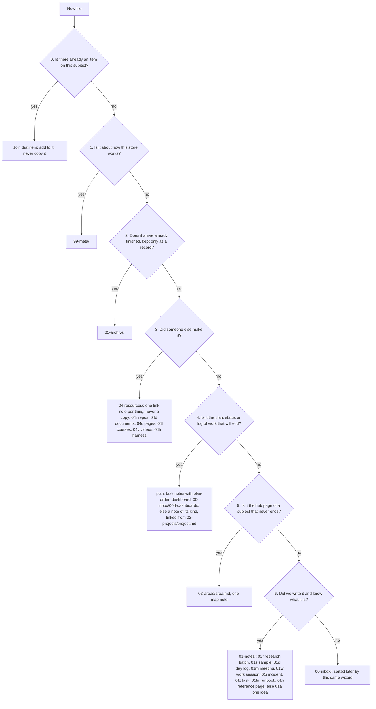

# Knowledge stores

Read this before saving notes, research, captured pages, or other learning
material, or when setting up or reorganizing a place that holds them. A
**store** is any folder that keeps knowledge: a knowledge repository's
root, a code repository's `docs/knowledge/`, or a project's shared files
folder. The goal is that two agents saving the same file pick the same
folder and the same name, and that a reader finds anything by following
at most three written lists.

## Contents

- [Which store?](#which-store)
- [The tree](#the-tree)
- [The wizard](#the-wizard)
  - [Research batches](#research-batches)
  - [Tasks](#tasks)
- [Item shape](#item-shape)
- [Naming rule](#naming-rule)
- [Hubs and maps](#hubs-and-maps)
- [Checks](#checks)
- [Adopting the standard](#adopting-the-standard)

## Which store?

Ask first: is the file about this repository's own system, saying why it
is so, what it is, or how to run or change it?

- **Yes:** it is documentation. It goes in the repository's `docs/` kind
  folders (`decisions/`, `runbooks/`, `specs/` and the like) and follows
  the docs rules in `SKILL.md`, not this file.
- **No:** it is knowledge, something learned or gathered. It goes in the
  knowledge store, and the wizard below places it. In a code repository
  the knowledge store is `docs/knowledge/`, and the docs checks (front
  matter, prose linting) skip that folder.

A docs folder that holds the evidence behind decisions is named
`evidence/`, one summary per decision, linking to the full research in
the knowledge store. Keep the word "research" for the knowledge store, so
a folder name never answers yes to both sides of the question above.

## The tree

```text
<store>/
├── README.md          hub: a written map of the top folders
├── 00-inbox/          not sorted yet
│   ├── 00c-clippings/   raw web captures not yet processed
│   ├── 00d-dashboards/  live dashboard pages and boards still being iterated on
│   ├── 00e-excalidraw/  drawings not yet sorted
│   └── 00t-thoughts/    quick ideas and to-dos
├── 01-notes/          we wrote it
│   ├── 01a-atomic/      a note on one idea
│   ├── 01d-daily/       a log of one day's work, named YYYYMMDD.md
│   ├── 01h-handbook/    reference pages kept current, each with a handbook-kind: vocabulary, policy, catalogue
│   │   └── 01hr-runbooks/  steps for a person or an agent to do one thing
│   ├── 01i-incidents/   one problem: what broke, the root cause, the fix
│   ├── 01m-meetings/    one meeting: attendees, agenda, notes, next steps
│   ├── 01r-research/    research batches, each registered with a number
│   │   ├── 01rb-batches/    one hub per batch, NNNN-<name>.md, linking the batch's notes
│   │   ├── 01ra-atomic/     a one-idea research note that fits none of the six below
│   │   ├── 01rc-check/      an independent review, verification or tool check of a batch
│   │   ├── 01rd-deviations/ where a batch departed from its spec
│   │   ├── 01re-evidence/   what the sources said: findings, recall, extracts, run records
│   │   ├── 01rl-ledger/     the claims and their verdicts, one row each
│   │   ├── 01rp-protocol/   the question, method, prompts and spec a batch followed
│   │   └── 01rs-synthesis/  the answer a batch reached
│   ├── 01s-samples/     code or prototypes built as examples
│   ├── 01t-tasks/       one note per task, its state in front matter; the backlog is every task not done
│   └── 01w-worklogs/    one work session on one subject: what was done, files changed
├── 02-projects/       work that will end: one map note per project, <project>.md, links only
├── 03-areas/          subjects that never end: one map-of-content note per area, <area>.md
├── 04-resources/      someone else made it; kept to reference
│   ├── 04c-clippings/   web pages: one link note each, no copied text
│   ├── 04d-documents/   papers and documents: one link note each, the file not kept
│   ├── 04h-harness/     agent harness material: 04hp-prompts/ for chat thread exports
│   ├── 04l-learning/    courses and curricula
│   ├── 04r-repos/       one link note per repository our notes cite, owner-repo.md, made by a script
│   └── 04v-video/       videos and their transcripts
├── 05-archive/        arrived finished, kept as it was
└── 99-meta/           how this store works: ORGANIZE.md, tools, templates, setup
```

The top folders are INPARA: Inbox, Notes, Projects, Areas, Resources,
Archive, plus `99-meta/`. Top folders are `NN-name`; second-level folders
in `00-inbox/`, `01-notes/` and `04-resources/` are `NNx-name`, with the
parent's number.

- **Letter rule.** A kind's letter is the first letter of its word. A
  sub-kind adds a second letter under its parent: `01hr-runbooks` under
  `01h-handbook`, `01re-evidence` under `01r-research`. A letter is given
  only when ten or more real notes need it and they fit no kind that
  exists; a retired letter is never reused, so old links never point to
  the wrong kind.
- A new lettered folder is added only by a new version of the standard,
  never by an agent saving a file. Create each folder when its first file
  arrives.
- **Flat folders.** Inside `00-inbox/`, `01-notes/` and `04-resources/`
  the only folders are the lettered kind folders and their sub-kind
  folders. There are no item folders and no numbered batch folders there.
- **Files that are not notes** (code, data, drawings, HTML pages we made)
  sit in a lettered sub-kind of the kind folder whose notes cite them: the
  kind's letters, then `d` for `data`, `s` for `scripts`, `i` for `images`
  or `p` for `pages`. For example `01-notes/01h-handbook/01hd-data/`,
  `01-notes/01h-handbook/01hs-scripts/` and
  `01-notes/01r-research/01re-evidence/01rep-pages/`. Files in a data or
  pages folder keep their names; scripts and images follow the naming rule.

## The wizard

Ask in order. The first yes decides.



| # | Question | If yes | Test for the hard cases |
|---|---|---|---|
| 0 | Is there already an item on this subject? Read the hub lists from `README.md` down and search the names and titles. | Join it: edit that note, or link to it. | A copy of an item is never a new item. |
| 1 | Is it about how this store works: its rules, checks, tools, templates, or setup? | `99-meta/` | A page on how we work in general (a vocabulary, tool choice, review rules) is a handbook page (step 6). |
| 2 | Does it arrive already finished or replaced, kept only as a record (an old snapshot, a finished review)? | `05-archive/<project or subject>/`, unchanged, the folder named by a word already in this standard, with a README that lists every file | An item already saved that later finishes **stays where it is** with `status: replaced` in its front matter, so links keep working. Only something retired as a whole record goes to the archive. |
| 3 | Did someone else make it? | `04-resources/<kind>/`, flat, one **link note** per thing and never a copy of its text: `04r-repos/` one note per repository our notes cite, `<owner>-<repo>.md`, made and removed by a script from the repositories the notes cite; `04d-documents/` a paper or document; `04c-clippings/` a web page; `04l-learning/` a course; `04v-video/` a video; `04h-harness/04hp-prompts/` agent chat exports | A link note holds `id`, `title`, `description` and `url` in front matter, and the list of notes that cite it; nothing else. The text, PDF, video or repository it points to is not kept in git: read it at its URL, or keep a local copy under `.cache/`, which git ignores. A note that cites a repository carries a `repos:` front matter list naming its repo notes, written by the same script. Our notes about a resource are not a resource: they go to step 6 and link to it. |
| 4 | Is it the plan, status, or log of one piece of work that will end? | A plan is task notes, not a page: one note per step in `01-notes/01t-tasks/` with `plan-order` (see [Tasks](#tasks)). A status picture or dashboard is a page in `00-inbox/00d-dashboards/`, drawn from the notes' fields. Anything else is a note of the kind it is, linked from the project's map note `02-projects/<project>.md`: a runbook or reference page in `01-notes/01h-handbook/`, a note on one idea in `01-notes/01a-atomic/`, a review, audit or dated snapshot kept only as a record in `05-archive/` | A project is one map note with links only, like an area; it never has a folder, and there is no plans folder. A plan or dashboard never goes in the handbook. |
| 5 | Is it the hub page of a subject that never ends? | `03-areas/<area>.md`, one map note, no folder | The map is a list of links, each with a reason. Everything it links lives elsewhere. A living page about the area (a catalogue, a status page) is a handbook note the map links. |
| 6 | Did we write it, and do we know what it is? | `01-notes/`: `01r-research/` for a registered research batch (see below), `01s-samples/` for example code, `01d-daily/` for one day's log, `01m-meetings/` for one meeting, `01w-worklogs/` for one work session on one subject, `01i-incidents/` for one problem and its fix, `01t-tasks/` for one task, `01h-handbook/01hr-runbooks/` for steps to do one thing, `01h-handbook/` for a reference page kept current that holds many ideas, with `handbook-kind:` set to `vocabulary`, `policy`, `profile`, `catalogue`, `how-we-work` or `reference` (a note that fits none of them is not a handbook note), otherwise `01a-atomic/` | Research is a question answered from sources, saved as a numbered batch. A plan or review for one project is step 4, even when it cites sources. An option comparison is research; a how-to is a runbook. A worklog covers one session; the day log covers the whole day and links to it. A note on one idea is atomic even when edited later. |
| - | None of the above | `00-inbox/` | Sorted later with this same wizard. |

**Tie rule:** if two answers still fit, pick the one a stranger would look
in first, and say why in the note.

Projects and areas are the human front end: a person browses maps. Notes
and resources are kept by agents, and every one of them is reachable from
some map.

### Research batches

A research batch has a row in the store's batch register (for example
`99-meta/BATCHES.md`) before its first note is saved. Its hub is
`01-notes/01r-research/01rb-batches/NNNN-<name>.md`, where `NNNN` is the
register number, and it links every note of the batch. Each note sits flat
in the folder of its kind (`01rp-protocol`, `01re-evidence`,
`01rl-ledger`, `01rc-check`, `01rs-synthesis`, `01rd-deviations`, or
`01ra-atomic` for a one-idea note that fits none of the six), is named by
its id, and names its batch in front matter: `batch: NNNN-<name>`.
Nothing else sits directly in `01-notes/01r-research/`.

### Tasks

Each task is one note in `01-notes/01t-tasks/`, named by its id, with the
same front matter:

```yaml
---
id: 2026110723150001
type: task
title: "TASK-0001: Save the network secret so agents can reach the server"
label: TASK-0001
external-refs: []     # the same task's keys in other trackers: ["github:owner/repo#12", "linear:TEAM-3"]
state: ready          # jon | doing | ready | blocked | idea | parked | done
waits-on: []
owner: "<who does it>"
horizon: "Now"
source: "<where the task came from>"
plan-order: 40        # optional: its place in the plan, lower first
jon-action: ""        # optional: the one thing the owner must do; set only when no agent can
tags: [task, 11-2026]
---
```

`jon` means waiting on the store's owner. The backlog is a state, not a
folder: a task never moves when its state changes, so its links keep
working, and the hub `01t-tasks.md` lists every task by state. A new task
takes the next free `TASK-NNNN` label. A task synced in from another
tracker takes the next free label too, and its source key goes in
`external-refs`, never in `label`.

The plan is fields on tasks, not a page. A task is on the plan when it
has `plan-order`; `waits-on` gives the arrows and `state` the colour. A
dashboard in `00-inbox/00d-dashboards/` draws the plan from those fields,
so the plan changes only when a task's front matter changes, and no page
holds a copy of it. A step that is not a task yet gets a task note first.

## Item shape

- A note is **one file**. In `01-notes/` and `04-resources/` a note never
  becomes a folder; a page or resource note links the notes and files that
  belong with it.
- **One home, many links.** An item can belong to many areas and
  projects. Each one links to it; nothing is copied.
- The note starts with front matter. The `description` is what the hub
  shows, so write the words someone would search for:

  ```yaml
  ---
  title: Joining the private network as an agent
  description: How a cloud agent joins the private network with a tag, and how to revoke it.
  status: draft | current | replaced
  date: 2026-11-03
  id: 2026110317440501
  tags: [note, 11-2026, networking]
  ---
  ```

- **`id`** is the moment the note was made, in the store's local time to
  the second, plus a two-digit counter: `YYYYMMDDhhmmss##`, 16 digits. The
  counter runs 01 to 99 within a second; when a second is full, take the
  next free second. It never changes and is unique in the store. If two
  agents pick the same id, the second takes the next free number. Before
  writing a new note, look for one with the same title or overlapping
  text, and edit it instead of making a duplicate.
- **`tags`** sit in front matter only, as a one-line list; body text never
  holds a `#tag` (write a literal `#` before a word as `&#35;`). Tags come
  from fixed rules, so two agents give the same tags:
  - **kind**: the word of the note's folder (`note`, `research`,
    `handbook`, `runbook`, `task`, `meeting`, `moc`, `project`,
    `resource`, `clippings` and the like);
  - **month**: `MM-YYYY` from `created`, else from the id;
  - **area**: the store's area ids, from its fixed list (for example
    `99-meta/tags.md`); each area's map links every note tagged with it;
  - **topic**: words from the store's fixed topic list found in the title,
    description or headings.
  `05-archive/`, `99-meta/` and the day logs are not tagged by these rules.
- **Map shape.** When the store has map templates in `99-meta/templates/`
  (`area-map.md`, `project-map.md`), every map follows its template: the
  hand-written sections in the template's order, then one block of link
  sections that `check_knowledge_store.py <store> --maps-write` writes from
  the map's link lines, sorted by target folder and path. To add a link,
  put `- [Name](path): reason` in the block and run it.

## Naming rule

1. **A note is named by its bare id**: `<id>.md`. The title and
   description are in front matter; the folder and the front matter's
   `type` say what kind of note it is. A meeting is `meeting-<id>.md`.
   Research kind folders and `01t-tasks/` hold id names only.
   - **Word names** are kept by maps and hubs (`README.md`,
     `<folder>.md`, `02-projects/<project>.md`, `03-areas/<area>.md`),
     role files (rule 6), and files that are not notes. A word name is a
     **slug from the title**: drop "a", "an" and "the", keep the first five
     words, write them lowercase-kebab: "How the agent joins the network"
     becomes `how-agent-joins-network.md`.
2. **No dates, timestamps, or versions in word names.** The date goes in
   front matter; git keeps versions. Two exceptions: a batch hub in
   `01rb-batches/` is `NNNN-<name>.md`, its register number, so batches
   sort in run order; and a day log in `01-notes/01d-daily/` is named by
   the date it covers, `YYYYMMDD.md`.
3. **No catch-all words** (misc, general, other, temp, old, backup, new),
   and a name never repeats a folder name higher up its own path.
4. **Collisions.** Same subject: it is the same item, so join it. A
   different subject: add the title's next word until the slug is unique.
   Never add a number.
5. **Never rename after saving.** Links point at names, and repeated
   renames are the largest cost a reorganization has. Fix the title in
   front matter instead.
6. **Capitals only for role files:** `README`, `AGENTS`, `CLAUDE`,
   `ORGANIZE`, `LICENSE`, `SECURITY`, `CHANGELOG`, `CONTRIBUTING`,
   `CODEOWNERS`, `SKILL`, and research-batch template files (`SPEC`,
   `SYNTHESIS`, `LEDGER`, `DEVIATIONS`, `PRIOR-CORPUS`, `RECALL`,
   `REVIEW`, `CORRECTIONS`). Python files are `snake_case.py`.
7. **Limits:** 63 characters per folder name, 255 per path, no Windows
   device names, and no two paths that differ only by letter case.
8. **Unique names.** Every note's file name is unique in the store, outside
   `05-archive/` and the data and scripts folders, so a name or a
   `[[wikilink]]` finds one file.

## Hubs and maps

A reader should choose without opening files, and trust that the lists
are complete.

- The root `README.md` and each folder's **hub note** are written maps:
  they link every child, each link with its description on the same line.
  Below the root, a folder's hub note is `<folder>/<folder>.md`
  (`01-notes/01-notes.md`, `01-notes/01a-atomic/01a-atomic.md`); an older
  `<folder>/README.md` still counts. Read `README.md`, then a top hub,
  then a lettered hub or a map note, then the one item: three levels to
  anything.
- The root `README.md` says in one sentence: "Before saving, run the
  wizard in 99-meta/ORGANIZE.md; to find anything, follow the hub lists
  from here."
- Every note in `01-notes/` and `04-resources/` is linked from at least one
  area or project map. A hub link does not count: a map link says why the
  item matters to that subject. Three things are covered another way: a
  day log by its hub `01d-daily.md`, a research note by its batch hub, and
  a repo note in `04r-repos/` by the notes that cite it.
- Hubs and maps are written by hand (or by `--maps-write` from hand-written
  link lines); the checks keep them complete. Hand lists without a check
  go stale, and generated lists lose the reason each link exists.
- An agent that uses the store names the files it opened, so a reader
  can check what its answer rests on.

## Checks

Run `scripts/check_knowledge_store.py <store>`. It needs only the Python
standard library.

| Check | Fails when |
|---|---|
| root | the store root holds anything but the top folders, dot files, and `README.md`, `AGENTS.md`, `CLAUDE.md`, `LICENSE`, `SECURITY.md`, `CONTRIBUTING.md`, `CHANGELOG.md`, `CODEOWNERS` |
| names | a file or folder breaks the naming rule: a bad word name, an id that is not a real `YYYYMMDDhhmmss##`, a word name in a research kind folder or `01t-tasks/`, a batch hub not named `NNNN-<name>.md`, anything in `01r-research/` but its eight folders and hub, or two paths that differ only by letter case |
| folders | a folder inside `00-inbox/`, `01-notes/` or `04-resources/` that is not a lettered kind folder, its sub-kind, or (in `01-notes/`) a data, scripts, images or pages sub-kind |
| links | a relative Markdown link points to nothing |
| orphans | no chain of links from `README.md` reaches a file |
| twins | two written Markdown notes have the same bytes |
| hubs | a hub note does not link one of its children, or a link line has no description |
| maps | a note in `01-notes/` or `04-resources/` has no area or project map linking it (a repo note in `04r-repos/` is exempt); `02-projects/` holds a folder |
| research | a note in a research kind folder has no `batch: NNNN-<name>`, names no batch hub, or its batch hub does not link it |
| shape | an area or project map is not in the shape `--maps-write` writes from its template (only when the store has templates) |
| tasks | a task note lacks `type: task`, a `label` `TASK-NNNN`, an `external-refs` list of `<system>:<key>` strings (`[]` when none), or a `state` from the list above |
| handbook | a note directly in `01-notes/01h-handbook/` (not its hub or `01hr-runbooks/`) has no `handbook-kind:` from the list in step 6 |
| tags | body text holds a `#tag`, or a note's one-line `tags` list lacks its folder's kind words or its month (area and topic lists belong to each store, so their checks are the store's own) |

- Captured material keeps its original names and is skipped by the names,
  links, and twins checks: anything inside an item folder of
  `05-archive/` or a sub-kind folder of `04-resources/`, and anything in a
  `sources/` or `data/` folder or a data or pages sub-kind folder.
- `--path <relative path>` checks one proposed name and its folder before
  saving.
- `--hubs` prints the lines each hub is missing.
- `--maps-write` rewrites every area and project map into its template's
  shape.
- `--since <git ref>` (exit `2` if the ref is not a commit; a store that
  did not exist at the ref counts as empty) fails names only on new files, and the other checks
  only when their count rose, so an existing store with old faults can
  adopt the check without fixing everything first.
- `--find <path>` prints the store root holding a path (the nearest
  folder with `99-meta/ORGANIZE.md`).
- Exit `0` clean, `1` violations (one `FAIL <check> <path>: <why>` line
  each), `2` bad input.

A hook that runs after a write misses shell writes, so a commit hook and
CI are the backstop.

## Adopting the standard

1. Create `README.md` with the one-sentence rule, `99-meta/ORGANIZE.md`,
   and the hub `99-meta/99-meta.md` that links it. `ORGANIZE.md` is the
   marker the check looks for; it holds the store's version of this
   standard, or a pointer to where that version lives. Create each other
   top folder and its hub `<folder>/<folder>.md` when the first item
   arrives.
2. Tell agents. In a repository's `AGENTS.md`:

   ```markdown
   ## Where knowledge goes

   Knowledge (notes, research, captured sources) lives in `docs/knowledge/`
   and follows `docs/knowledge/99-meta/ORGANIZE.md`.
   - Before saving, run its wizard: answer the steps in order, take the
     first yes, then name the file by the naming rule.
   - One home per item. Link to it from every map that uses it; never copy.
   - Every new item gets one line, with a one-line summary, in its hub.
   - Name a note by its id, give it its tags in front matter, and link it
     from an area or project map.
   - To find something, start at README.md, then the hub, then only the
     items you need. Name the files you opened.
   ```

3. Run the check in CI against the pull request's base, with the script
   pinned by commit from a repository the CI can read without a token:

   ```yaml
   - uses: actions/checkout@v5
     with:
       fetch-depth: 0
   - name: Knowledge store check
     env:
       BASE: ${{ github.event.pull_request.base.sha || github.event.before }}
       PIN: <commit of the repository that holds the script>
     run: |
       curl -fsSL "https://raw.githubusercontent.com/jonhill90/skills/$PIN/skills/organize-repository/scripts/check_knowledge_store.py" \
         -o "$RUNNER_TEMP/check_knowledge_store.py"
       base="$BASE"
       # A new branch has no before SHA; after a force push it is not in the clone.
       if [ -z "$base" ] || ! git cat-file -e "$base^{commit}" 2>/dev/null; then base=origin/main; fi
       python3 -I "$RUNNER_TEMP/check_knowledge_store.py" docs/knowledge --since "$base"
   ```

To leave the standard, delete `99-meta/ORGANIZE.md`: the check then treats
the folder as not a store. Nothing else depends on it.
